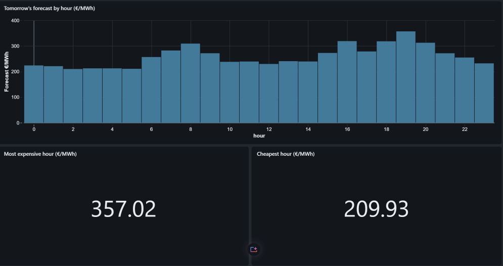
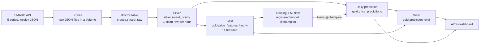
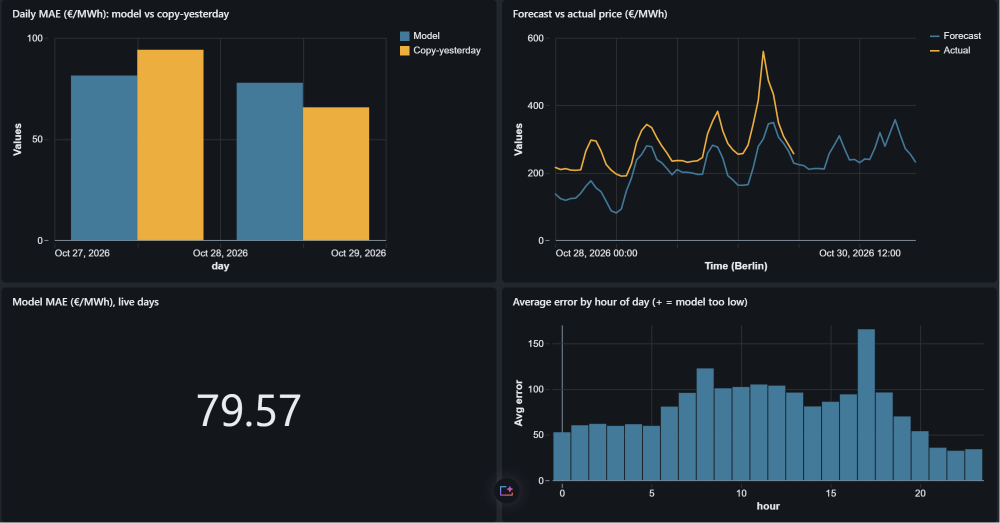

# German Day-Ahead Electricity Price Forecasting on Databricks

Every morning at 08:00, a scheduled Databricks job downloads the latest German electricity market data, runs it through a medallion lakehouse and forecasts **tomorrow's 24 hourly day-ahead prices** (bidding zone DE-LU) with a model from the MLflow registry. The forecasts are stored, compared with the real prices once they are published, and shown in an AI/BI dashboard.

Built end to end on **Databricks Free Edition** with public data from [SMARD](https://www.smard.de) (Bundesnetzagentur).



---

## At a glance

| | |
| --- | --- |
| **Question** | What will electricity cost in Germany tomorrow, hour by hour? |
| **Data** | SMARD: day-ahead price, grid load, wind onshore, wind offshore, solar (hourly, since Oct 2018) |
| **Model** | HistGradientBoostingRegressor, 11 leakage-free features |
| **Offline result** | **MAE 27.01 €/MWh** on one year of test data, **−11 %** vs the best naive baseline |
| **Production** | One chained Databricks job, scheduled daily at 08:00 (Europe/Berlin), forecasts written with `MERGE` |
| **Monitoring** | Evaluation view (forecast vs actual vs baseline) + 2-page AI/BI dashboard |

---

## Architecture



| Layer | Contents | Object |
| --- | --- | --- |
| **Bronze** | Raw weekly JSON files exactly as received from the SMARD API (5 series), plus one Delta table built from them | Volume `bronze.raw_files`, `bronze.smard_raw` |
| **Silver** | Cleaned hourly data: UTC key + Berlin time, one column per series, starts at the DE-LU market split (1 Oct 2018), rows without a price removed, single-hour load gaps filled | `silver.smard_hourly` |
| **Gold** | Feature table: calendar features, lagged prices, lagged load / wind / solar | `gold.price_features_hourly` |
| **Predictions** | Tomorrow's 24 forecasts per day, with model version and timestamp | `gold.price_predictions` |
| **Evaluation** | Forecast vs real price vs copy-yesterday baseline, per hour (a view, always up to date) | `gold.prediction_eval` |

All objects live in the Unity Catalog catalog `energy_lakehouse`.

---

## The daily job

One job, defined as code in [`databricks.yml`](databricks.yml) (Databricks Asset Bundles), runs every day at **08:00 Europe/Berlin**, before the 12:00 day-ahead auction:

```
ingest ─► bronze_table ─► silver ─┬─► gold
                                  └─► predict
```

- **`depends_on`**: a step only starts if the previous one succeeded, so no forecast is ever made from stale data. `gold` and `predict` run in parallel after Silver.
- **Prediction step** ([`ml/03_predict.py`](ml/03_predict.py)): works out tomorrow's hours in Berlin time (23 / 24 / 25 hours on clock-change days), appends them to Silver, builds the features with the **same function** used for training, loads the model by its `@champion` alias and writes the forecasts with **`MERGE` on `ts_utc`**. Re-running the job overwrites, never duplicates.
- **Guards**: before predicting, the script checks that Silver has no gap before tomorrow, that the row count matches the number of hours, and that no feature is NULL. If any check fails, the run fails visibly instead of silently writing a bad forecast. (HistGradientBoosting accepts NULLs without complaint, and a gap would silently shift every lag.)
- **Same code on the laptop and in the job**: [`common/env.py`](common/env.py) detects where the code runs and picks Databricks Connect + a local profile, or the job's own Spark session + login.

First scheduled run: 29 Oct 2026, 08:00, succeeded in 8 m 42 s.

---

## How success is measured

A model without a baseline proves nothing, so every model is compared against two **naive baselines**:

| Baseline | Rule |
| --- | --- |
| Same hour yesterday | Tomorrow's price at 14:00 = today's price at 14:00 |
| Same hour last week | Tomorrow's price at 14:00 = the price at 14:00 seven days earlier |

**Metric:** MAE (mean absolute error) in €/MWh.
**Split:** by time, never random. Train = Oct 2018 – Sep 2025, test = **1 Oct 2025 – 20 Oct 2026** (~1 year, all seasons, 9,240 hours).

### Offline results (test period)

| Model | MAE (€/MWh) | vs best baseline |
| --- | --- | --- |
| Baseline: same hour last week | 38.55 | — |
| Baseline: same hour yesterday | 30.26 | — |
| Linear Regression | 27.28 | −10 % |
| **HistGradientBoosting** | **27.01** | **−11 %** |

The winner is registered in Unity Catalog as **`energy_lakehouse.gold.price_forecaster`** (version 1, alias `@champion`) with an input/output signature. Production code only ever loads `@champion`, so a better version can be promoted by moving the alias, with no code change.

The gap between the two models is small (0.27 €/MWh): **the features are the limit, not the algorithm.**

### Error analysis

Where does the model fail? ([`ml/02_error_analysis.py`](ml/02_error_analysis.py))

| Finding | Evidence |
| --- | --- |
| Weakest at **midday** (solar) and the **evening peak** | MAE ~20 at night, ~31–34 at 11–17 h, ~36 at 19–20 h |
| **Weather-driven spikes**: model far too low | 25 Nov 2025: real 270–373 €/MWh, model 112–210 (signed error +94) |
| **Public holidays**: model too high | 1 Jan −79, Easter Sunday −68, 1 May −70 |
| **Price-crash days** (lots of wind / sun): model too high | 2 Jul −73, 21 Sep −76, 24 Oct −100 |
| **"One day late" at turning points** | 20–21 Sep too high, 22 Sep too low: the model leans on yesterday's price |

Errors follow **volatility**, not the season: February was the best month (15.6), September 2026 the worst (43.6).

### Live results

Since 27 Oct 2026, every day's forecast is compared with the real prices in `gold.prediction_eval`:

| Day | Model MAE | Copy-yesterday MAE |
| --- | --- | --- |
| Tue 27 Oct | 31.5 | 45.2 |
| Wed 28 Oct | 81.4 | 94.1 |
| Thu 29 Oct | 77.8 | 65.6 |

Late October 2026 was extremely volatile (an evening peak of ~560 €/MWh on 29 Oct; even the baseline is off by 65–94). The live errors show the same pattern as the offline analysis: the model has the right daily shape but misses weather-driven levels, most of all at the morning and evening demand peaks. Three days are too few to judge; the view keeps collecting.



---

## Design rules

- **No data leakage.** The forecast for day D+1 is made on day D at 08:00, before the 12:00 auction. The model only uses what is known at that moment:
  - **Prices** are lagged by **≥ 24 h** (D's prices are known since the previous day's auction).
  - **Load, wind and solar** are measured *after* the hour, so they are lagged by **≥ 48 h**.
  - **Calendar features** (hour, weekday, month, weekend) never leak; they are computed from German local time.
- **One feature logic.** Features are built by a single function, `build_features()` in [`features/feature_logic.py`](features/feature_logic.py), used by the Gold table, training, error analysis and the daily prediction, which avoids training/serving skew.
- **Time resolution: hourly.** Since 1 Oct 2025 the day-ahead market trades in 15-minute periods, but only hourly data gives 8 consistent years of history. SMARD's hourly price is the average of the four quarter-hours.
- **Time zones:** everything is keyed on **UTC**. Berlin time repeats an hour at the October clock change, so it can't be a key. "Tomorrow" is built from Berlin midnight to Berlin midnight, so clock-change days get 23 or 25 hours automatically.
- **Idempotent pipeline:** Bronze / Silver / Gold are rebuilt with `overwrite`, predictions are written with `MERGE`. Running anything twice gives the same result.
- **Reproducible runs:** every training run is logged in MLflow (parameters, metric, model, Git commit), with a fixed `random_state`.

---

## Tech stack

- **Databricks Free Edition**: Serverless compute, Unity Catalog, Delta Lake, MLflow (tracking + model registry), Jobs, AI/BI dashboards
- **Databricks Asset Bundles** (`databricks.yml`) to define jobs as code
- **Python 3.12**, **PySpark**, **pandas**, **scikit-learn**, **MLflow**, **SQL**
- **Databricks Connect** and the **Databricks extension for VS Code** for local development
- **uv** for the Python environment

---

## Repository structure

| Folder / file | Purpose |
| --- | --- |
| `setup/` | Creates the catalog, schemas and Volume (run once) |
| `bronze/` | Downloads SMARD data (`01_ingest_smard.py`) and builds the Bronze table (`02_build_bronze_table.py`) |
| `silver/` | Cleans and reshapes the data into the Silver table |
| `gold/` | Builds the feature table |
| `features/` | Shared feature logic (`FEATURES`, `build_features()`) |
| `common/` | Runtime helpers: Spark session and MLflow login for laptop vs job |
| `ml/` | Training (`01`), error analysis (`02`), daily prediction (`03`) |
| `explorations/` | SQL checks, baseline, publication-delay check, evaluation view |
| `docs/` | Dashboard screenshots |
| `databricks.yml` | Job definitions and schedule (Asset Bundle) |

---

## Next steps

- **v1.1 features**, driven by the error analysis: a public-holiday flag and **SMARD's day-ahead forecasts** of load / wind / solar (the weather information the model is missing on spike and crash days) → retrain, register as version 2, move `@champion`
- Compare model versions on a **fixed** test window (the test set currently grows with every new day)
- **v2:** weather forecasts (Open-Meteo), gas and CO₂ prices, 15-minute forecasts
- A dashboard schedule right after the job, and alerts when the job fails

---

© 2026 Yassmine El Aiadi. All rights reserved. This repository is shared as a portfolio project; please don't reuse the code without permission.